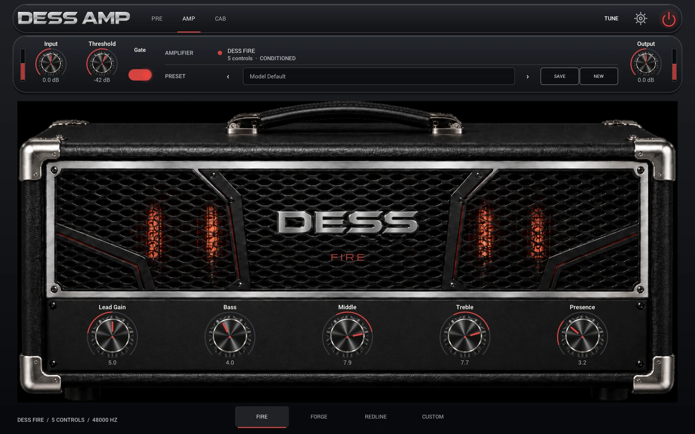
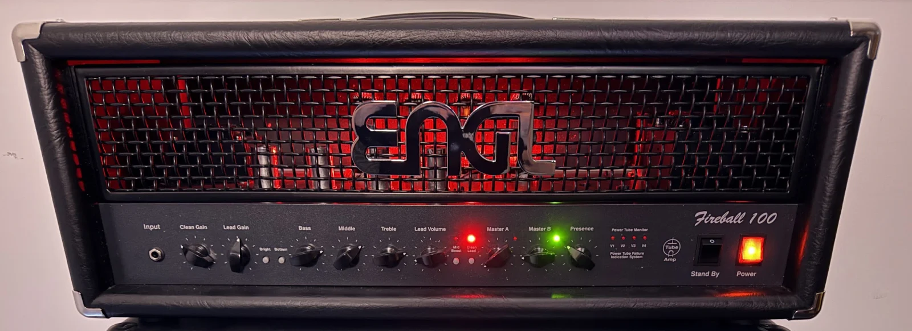

# DessAmp Player

DessAmp Player plays conditioned guitar amplifiers. Choose a factory head at the bottom
of the editor, or select **CUSTOM** and open your own `.dess` amp. Each head exposes the
controls learned by its model. The package contains its manifest and model payloads.
The manifest determines DSP order independently of the visual knob layout.

This is the source repository for the player, capture and training tools, and
DessFire on the HeadRush Flex Prime. The public checkout includes the Core and
trainer sources, the Flex Prime renderer and the owner setup guide. The studio
editor artwork, factory audio bank and pedal installation kit are supplied
separately. See [the project layout](#repository-layout) for entry points.

The current private listening catalogue is ordered DESS FIRE (the fully conditioned
physical Fireball), DESS FORGE (the morph/blend model), then DESS REDLINE. The
trained Gain + US-to-BRIT Morph experiment failed its frozen external audit and
remains research evidence only. The accepted private-listening Redline shape is
one product family with a code-bound US/BRIT selector over two independently
validated packages; their package path is persisted and loading remains off the
audio thread. These names describe development intent, not redistribution
approval for any model artifact.

## Capture your own physical amp

Start with the [physical amp capture walkthrough](docs/physical-amp-capture.md).
It takes you from a measured reamp path through recording, training, independent
evaluation, exporting a self-contained `.dess` file and loading it in the player.
Each training take plays the same 190-second NAM v3.0.0 `input.wav` with the
amp held at one recommended setting. [Get the sweep and verify your copy](docs/physical-amp-capture.md#2-get-the-training-sweep-and-check-the-signal-path).

With this repository open in Codex, ask in plain language or name the skill.

> Help me capture my amp for the DessAmp plugin. Show me which NAM input to
> play, then guide me through the Trainer's suggested knob settings one take
> at a time.

Start in the [trainer folder](trainer_source/README.md) for the beginner
templates, how active learning works, and what the Fireball run took in
captures, time and GPU cost. The [capture skill](.agents/skills/dessamp-conditioned-training/SKILL.md)
is included in the checkout. The [command-line runbook](docs/training-runbook.md)
also works without Codex.

## Current scope

- macOS standalone app, Audio Unit v2, and VST3
- iPhone and iPad standalone and AUv3 with a portrait and landscape touch interface
- native DessFire integration on HeadRush Flex Prime HG12, firmware 5.2.0.2a405ee
- Windows x64 standalone and VST3 build targets
- portable `.dess` package loading
- amplifier-scoped `.desspreset` libraries, Save/Save As New, and Model Default recall
- four Version C factory cabinets, cabinet bypass, and custom mono WAV IR loading
- interface input-headroom adjustment and practical Auto Input level matching
- conditioned WaveNet inference and the conditioned A2 Full runtime path
- session recall and amplifier-scoped preset navigation
- PRE pedal bank, AMP head, and CAB impulse-response views

This repository is a local product experiment. It is not signed, notarized,
installed, or published by default. Model packages, IRs, captures, generated
art, and source code have separate provenance and release gates.

## Save a sound

On the AMP screen, change the controls and tap **SAVE**. From **Model Default**,
DessAmp asks for a name and stores your sound in the current amp’s bank. Use
the preset picker to recall it or return to **Model Default**. Once a user
preset is selected, **SAVE** updates it; **NEW** saves a separate sound. The
preset captures the amp, pedal, cabinet and signal settings together. Switching away from an edited sound offers Save, Discard and Keep Editing. Cabinet
WAVs and custom amp packages must remain available.

FIRE, FORGE, REDLINE and imported amps keep their own banks. On Mac the
standalone and plug-ins use the same local preset folder. The iOS standalone
and AUv3 have separate sandbox libraries. A DAW project can still restore the
plug-in state without creating a named preset.

Tap **TUNE** at the top of the player to tune one guitar string at a time.
It reads the clean input, shows the nearest chromatic note and cents at
A4 = 440 Hz, and leaves the rig audible. Choose **DONE** to return.
See [tuner behavior and verification](docs/tuner.md) for the signal path
and how to repeat the pitch checks.

## Repository layout

| Path | What it contains |
| --- | --- |
| [NeuralAmpModeler](NeuralAmpModeler/) | The player UI, presets, audio processing, and desktop app and plug-in targets. |
| [NeuralAmpModelerCore](NeuralAmpModelerCore/) | The native model loader and conditioned amplifier runtime shared by the player and DessFire. |
| [ios](ios/) | iPhone and iPad standalone player, embedded AUv3, touch tests and App Store preflight. |
| [HeadRush](HeadRush/) | **DessFire on HeadRush Flex Prime HG12.** Device requirements, setup and verification for firmware 5.2.0.2a405ee. |
| [capture_companion](capture_companion/) | Capture projects, the measurement queue and active-learning recommendations. |
| [trainer_source](trainer_source/) | Conditioned A2 training, evaluation, package export and cloud jobs. |
| [AudioDSPTools](AudioDSPTools/) and [iPlug2](iPlug2/) | Shared DSP and plug-in framework dependencies. |

On a supported HeadRush pedal with the DessFire kit installed, select
**Amp → DessFire → DessFire**. Lead Gain, Bass, Middle, Treble and Presence
control the captured amp. The native rig has played after a disconnected cold
start on the tested Flex Prime. For the supported firmware, kit requirements
and hardware test status, see the [Flex Prime guide](HeadRush/README.md).

## Design and validation

Generated artwork remains a shell only: operational labels, values, knob
pointers, arcs, LEDs, disabled states, and hit targets are rendered and bound
in code. The public architecture and manifest documents define that product
boundary; internal planning evidence is deliberately outside the staged source
tree.

Audio quality and visual quality are separate gates. Automated rendering proves finite output, conditioning response, and state recall; final tone approval requires level-matched listening in a DAW.

Conditioned A2 Full is implemented in both trainer and runtime, but every new
export remains a candidate until stable artifact validation, external
hidden-setting evaluation, current-Core readback, host validation, and owner
listening pass. Runtime compatibility and internal trainer ESR are not release
quality claims.

The CAB page loads custom mono WAVs separately from the amplifier.
The public source checkout omits the private factory audio and optional
runtime artwork. The listening build supplies these separately.

PRE drive captures follow the same file-level rights boundary. An ordinary
source build contains no drive models. Rights-cleared release banks belong in
`NeuralAmpModeler/resources/Drives`; a local listening build may opt into one
complete external bank with `DESSAMP_PRIVATE_DRIVE_DIR` and
`DESSAMP_PRIVATE_DRIVE_VALIDATION=YES`.

## Open-source readiness

The MIT source license does not grant redistribution rights for private
commercial-amplifier captures, trained packages, IRs, fonts, icons, or generated
art. Review [third-party notices](THIRD_PARTY_NOTICES.md), the
[security policy](SECURITY.md), and the non-authorizing
[release process](docs/release-process.md) before creating a public history or
release bundle. Internal readiness, remediation, and run-evidence records are
deliberately excluded from the staged public tree.

Contributor expectations, support boundaries, security reporting, and the
non-authorizing release checklist are documented in [CONTRIBUTING.md](CONTRIBUTING.md),
[SUPPORT.md](SUPPORT.md), [SECURITY.md](SECURITY.md), and
[docs/release-process.md](docs/release-process.md).

For a small, reviewable source tree and a reversible first-run reset, see
[repository hygiene](docs/repository-hygiene.md). Do not upload the working
directory or its historical object store as a substitute for the reviewed export.

Feedback is available from **Settings → Feedback**. See the [support options](SUPPORT.md).
