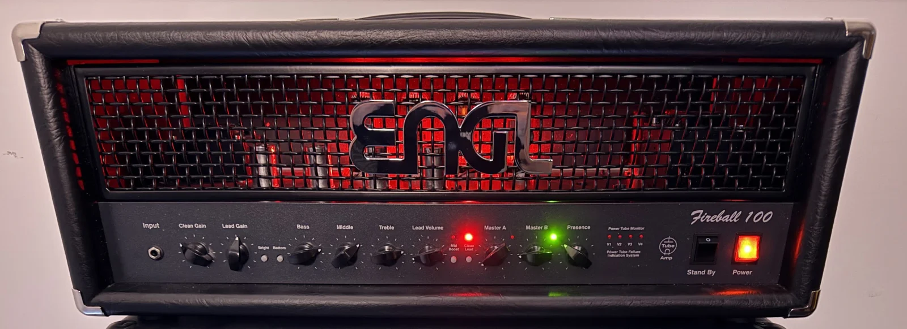

# From a physical amp to a playable DessAmp head

The file you share with another player is a **`.dess` amplifier package**. A `.desspreset` recalls settings for a particular amp. A mono cabinet IR is a separate WAV that you can choose on the CAB page.

To run this with Codex, say “Help me capture my amp for DessAmp.” Have your amp and channel, load box, interface send and return, and the controls you want to learn handy. For a project already in progress, give the Trainer data directory and project ID so the guide can pick up the pending take.

## 1. Define what you will capture

Choose one channel and name each control you want the model to learn. Write down everything that stays fixed. For a first run, start with one or two controls. Record the knob labels, actual ranges, default positions and exact model-vector order. Make a persistent Trainer project outside the repository. Use the physical-lead template as an example and substitute your own controls, measured calibration and stimulus. Keep the project ID and data directory so you can resume the same capture. [Project setup and commands](training-runbook.md#3-initialize-a-persistent-capture-project)

**Condition only the sounds you use.** For each knob you want in the plugin, pick the lowest, usual and highest setting you would actually play. Freeze everything else, including switches you normally leave alone. For example, if you use Gain from 3 to 7 on a 0–10 dial, set its model `minimum` and `maximum` to 0 and 1, its `display_minimum` and `display_maximum` to 3 and 7, and its unit to match the dial. A model value of 0.5 now means Gain 5. Use those same bounds for starter, candidate and held-out settings. Listen at both ends before committing. Each knob or switch you freeze removes combinations you would otherwise need to record and validate.

The physical Fireball lead project learned five controls. Lead Gain covered 9 o’clock to 3 o’clock, Bass/Middle/Treble each covered detents 4 through 9, and Presence covered 8 o’clock to 2 o’clock. Bright stayed on, Bottom and Mid Boost stayed off, and the master and lead volumes stayed fixed. For your amp, choose the ranges by ear. Start with a small list of candidate settings spread across those ranges and let disagreement guide additional takes.

*The physical head used for this capture. Use the ranges above to set up a take. The photograph shows the amp on a different day. Photo by Alexander Dess.*

## 2. Get the training sweep and check the signal path

Use the **Neural Amp Modeler v3.0.0 reamping signal**, named **`input.wav`** (previously **`v3_0_0.wav`**). Download the input outside the checkout. It is **3 minutes 10 seconds**, exactly **9,120,000 frames of mono 48 kHz, 24-bit PCM**. Keep the complete file, including the alignment blips and silence. Play it once per training take, with the knobs stationary. Keep normalization, fades, stretching and resampling off. [Download NAM’s input.wav](https://drive.google.com/file/d/1KbaS4oXXNEuh2aCPLwKrPdf5KFOjda8G/view?usp=sharing) · [NAM’s reamping instructions](https://neural-amp-modeler.readthedocs.io/en/latest/tutorials/colab.html#reamping-getting-data-for-your-model)

For the original download, `shasum -a 256 "/path/to/input.wav"` should print `70f8ec7f25686a1bd77f25973de8e51a6721e957e81eec121822e5e53366bc41`. Give this verified file to the initializer as `--input`. It stores a copy and records its hash with the project. A DAW can rewrite the WAV header. If a session copy differs, use the verified original as the reference and check that the decoded PCM matches before using the session copy for playback. On resume, check the existing project's input hash.

Send the dry track from the interface through the reamp box to the amp input. A tube amp needs its correctly rated load connected whenever it is running. Take the head-only return from a suitable load-box line output with cabinet simulation disabled. Never connect a speaker output to an interface input. Measure the send level, return level, input reference in dBu, polarity and loopback delay. Set one trim at the loudest intended setting and record it in the project. [Physical routing and capture protocol](../.agents/skills/dessamp-conditioned-training/references/capture-protocol.md)

### Logic Pro example

1. In **File → Project Settings → Audio**, choose **48 kHz** before importing the sweep. Use 24-bit WAV recording, turn off the metronome and count-in, and mark the start and end of the 190-second region. [Logic project sample rate](https://support.apple.com/en-sg/guide/logicpro/lgcpce0958b8/mac)
2. Create a mono **Sweep** track. Place the verified input on it at the start marker with no inserts or sends, region gain at 0 dB and the fader at unity. Route it only to the physical reamp output. In the Fireball session this was **MOTU M2 mono Output 1 → Palmer DACCAPO → amp input**.
3. Create a mono **Raw return** track from the load box's line output. The Fireball used a Two Notes Torpedo Captor into **M2 Input 2**. Set the Logic track to **No Output** with no inserts or sends. Keep interface direct monitoring from routing the return back into the reamp output. A monitoring track with a cabinet IR can feed a separate listening output. Verify your own load, channel numbers and levels before sending audio.
4. For each pending setting, move the knobs, leave them still, record-enable only **Raw return**, and record from the start marker through the end. Stop, disarm, and return to the start. Export the raw region as a mono PCM24 WAV at the project rate with normalization off and no tail. Check the frame count and import the return under the pending recommendation. The same Logic project and track routing can serve every take.

## 3. Check each learned control before recording a whole grid

Record the centre setting twice to measure repeatability. Then record low and high positions for each control with everything else fixed. Use the same alignment and trim, inspect the resulting signal, and listen to the same phrase at matched loudness. For a Tone or Presence knob, compare the change in high-frequency energy with the change in low-frequency energy. If the endpoint recordings nearly cancel, verify the input, switch state and return path before training. Different filenames or knob readbacks alone cannot establish an audible response. [Capture checks and pair validator](training-runbook.md#4-prove-capture-integrity-before-training)

## 4. Separate training, development and the final audition

Freeze hidden knob positions and record them on a **different dry performance** before training. Keep these positions out of starter captures and acquisition suggestions. Import each training return against its recommendation ID, store the accepted WAV hashes and back up the Trainer database. Use a separate development capture to select checkpoints. Once a holdout has guided a model change, keep its result as development evidence and reserve fresh material for the final check. [Evaluation reservation](training-runbook.md#5-freeze-the-hidden-audit-before-training) · [Training corpus](training-runbook.md#6-materialize-the-authoritative-training-corpus)

### Record one recommended setting

1. Open your project in the local Trainer. Read **Next recommended setting**, or click **Recommend next capture** if none is pending. The first round uses `coverage-v1` to start near the centre and then fill gaps. Read the displayed amp-face values and switch positions. Set them on the amp and tell the guide when you are ready.
2. Choose **Logic / WAV** to record the return in your DAW from the same start marker for exactly 190 seconds. Use **Import captured WAV** for that recommendation once the take passes the capture checks. Alternatively, after verifying the selected devices and levels, choose **Audio interface → Start playback and recording** to play the project input and record the mono return directly.
3. Check the return for clipping, silence, length and alignment. Keep the WAV and its validation result tied to the recommendation ID. Resolve a failed take before recording another. Between sessions, reopen the same project and read its pending recommendation and capture history.

### Let the models choose the next settings

After the starter set, train at least two independently seeded models on the accepted captures. The scoring tool plays a separate acquisition DI through them at the remaining candidate settings. Where their outputs disagree, another physical recording can help. The operator runs the candidate, scoring and import commands in the runbook, outside the Trainer UI. They exclude captured and reserved settings and queue a batch of suggestions. **Recommend next capture** now presents the next imported setting. When the batch is finished, rescore with the new captures before requesting another active-learning take. [Active-round commands](training-runbook.md#10-select-and-queue-the-next-active-captures)

At each checkpoint, review errors and listen across the controls. Another round is worthwhile if a part of the range is still poorly reproduced. If the physical repeats disagree, fix the recording path first. When the learning curve levels off, use the independent audit and listening checks to decide whether the model is ready. [Capture budgets and stopping criteria](../.agents/skills/dessamp-conditioned-training/references/evaluation.md#capture-count-planning)

## 5. Train, evaluate and export one member

Logic supplies the recordings. The conditioned training job runs separately. The Trainer database binds each accepted return to the dry input and the ordered control values. The operator freezes the training/validation split, stores the bundle in Google Cloud Storage (GCS), and runs one independently seeded **conditioned A2 Full** model per RunPod GPU. The worker saves checkpoints to GCS after validation epochs. At the end, the operator selects one model using internal validation and checks it against the reserved recordings in native DessAmp Core. [Trainer source](../trainer_source/README.md) · [RunPod preparation and submission](training-runbook.md#7-prepare-one-immutable-a2-bundle)

The trainer folder records the Fireball's actual capture count, GPU time window, cost estimate, selected seed, results and audit limits. [What the Fireball run took](../trainer_source/README.md#what-the-fireball-run-took)

Check the worst setting as well as the mean. Listen for the size and direction of each control's sweep on the same riff, including through a cabinet. A useful average error can still hide a weak treble sweep. Run the packaging command with your project ID, selected member, held-out report and friendly filename. Its JSON report gives the shareable file in **`package.path`**. Keep the source project, evidence and checkpoints for later work. [Native evaluation](training-runbook.md#9-evaluate-the-frozen-hidden-settings) · [Package command](training-runbook.md#11-package-one-selected-player-artifact)

## 6. Open the package in the player

Choose **CUSTOM** in the bottom amp selector and open the `.dess` file. The player validates its embedded models and keeps a private copy for session recall. The amp page shows the package's name and learned controls. Try a knob sweep, save the DAW session, close it and reopen it. Within the same instance, selecting CUSTOM after a factory head recalls the last custom amp. Selecting CUSTOM while it is active opens the picker for a replacement. A source build with no factory amps still offers CUSTOM.

To share the head, give the recipient the exported `.dess` file and, if appropriate, a separate cabinet IR you have permission to share. On another computer, import the package there before recalling the rig. Capture masters and training checkpoints stay with the project.
