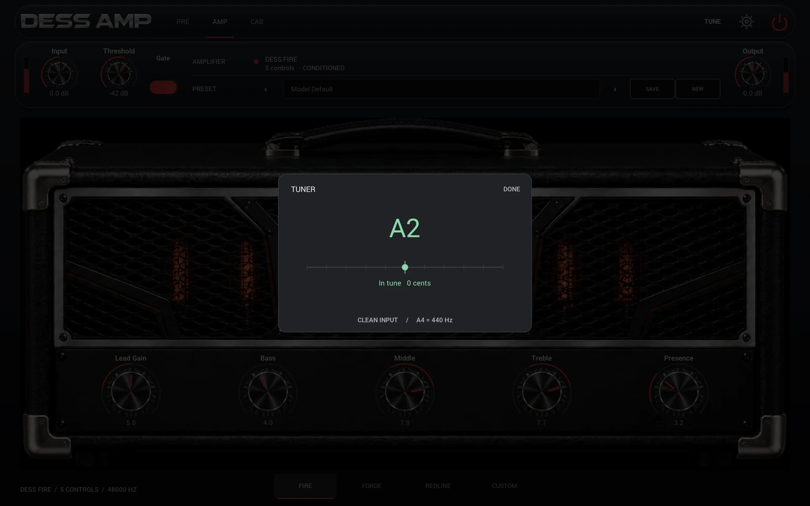

# Guitar tuner

Open **TUNE** in the header on Mac, iPhone or iPad, then play one string at
a time. The note includes its octave (the standard open strings are E2, A2,
D3, G3, B3 and E4). A point left of center means flat, right means sharp;
within three cents the note turns green. A4 is fixed at 440 Hz. **DONE**
goes back to the page you were on, as does Escape on Mac.



The input comes from the same live input channels as the player, before
trim, calibration, gate, pedals, amp and cabinet. No mute, reference tone,
host parameter or preset entry is involved. Tuning does not alter the audio
being monitored or recorded. A host must supply live input; silence,
unreliable pitch or stopped transport shows “Play one string.”

The audio callback folds the input to mono, averages to about 16 kHz and
publishes fixed-size windows only while the tuner is open. On the editor
thread an original implementation uses the normalized difference method
described by [de Cheveigné and Kawahara](https://pubmed.ncbi.nlm.nih.gov/12002874/),
then refines the lag against the waveform. Each reading uses roughly 0.1 s
of signal. The tested range is A0 through E6. It is a single-note
guitar tuner; it does not identify chords.

To repeat the detector check from the repository root:

```sh
qa=$(mktemp -d)
clang++ -std=c++17 -O2 -Wall -Wextra -Werror NeuralAmpModeler/tests/test_guitar_tuner.cpp -o "$qa/tuner"
"$qa/tuner"
```

The test checks plucked-string-like harmonics, detuning and a guitar
connected only to the second input at 44.1, 48, 96 and 192 kHz. It also
checks silence, DC, noise and reopening between notes. The iOS touch suite
in [ios/README.md](../ios/README.md) checks opening and dismissing the panel.
For an end-to-end listening check, send a clean DI or known 110 Hz A2 into
the live plug-in, open TUNE, and compare the reading to a reference tuner.
